<p align="center">
  <picture>
    <source media="(prefers-color-scheme: dark)" srcset="assets/plugin-icon-dark.svg">
    <source media="(prefers-color-scheme: light)" srcset="assets/plugin-icon-light.svg">
    
  </picture>
</p>

<h1 align="center">Netcatty Database</h1>

<p align="center">
  <strong>DBX-grade multi-database IDE workbench built natively for Netcatty's Host-Rendered Plugin Platform.</strong>
</p>

<p align="center">
  PostgreSQL · MySQL · MariaDB · SQLite · Redis · MongoDB · ClickHouse · Netcatty Vault SSH Tunnels · STARTTLS · Monaco SQL · Virtualized Inline Grid · Interactive ER Diagrams
</p>

---

## Highlights

- **100% Host-Rendered & Sandbox-Isolated (`main.browser`)** — Pure TypeScript wire-protocol engines running inside Netcatty's offline browser plugin sandbox (zero iframes, zero `eval`/`new Function`, zero Node companion required), paired with Netcatty's host-rendered native IDE primitives (`PluginCodeEditor`, `PluginDataGrid`, `PluginSplitPane`, `PluginErCanvas`).
- **22-Engine Catalog with Crisp Dual-Theme SVG/PNG Icons** — Dedicated light and dark brand icons for all 22 database engines, zero generic fallbacks.
- **Native Netcatty Vault SSH Tunnels & TLS/STARTTLS** — Connect directly over user-approved TCP/TLS, upgrade in-band via STARTTLS (`SSLRequest` / `CLIENT_SSL`) with explicit certificate fingerprint verification, or tunnel through any existing Netcatty Vault SSH host with durable revocable bindings (reusing Netcatty's SSH keys, jump hosts, and MFA without exposing credentials).
- **DBX Multi-Tab SQL IDE** — Host Monaco SQL editor with dialect highlighting (`pgsql` / `mysql` / `sql`), local schema-aware autocomplete, multi-statement execution, real query cancellation (`CancelRequest` / `KILL QUERY`), `Auto` / `Manual` transaction controls, visual `EXPLAIN` / `EXPLAIN ANALYZE` plan trees, persistent query history & saved snippets, and host AI SQL assistance.
- **Virtualized Editable Data Grid** — Server-side pagination, sorting, and `WHERE` filtering; double-click inline cell editing with `NULL` toggle; amber dirty-cell highlighting, floating pending-changes bar, unified Monaco SQL preview, atomic commit/rollback, Cell/Row Inspector drawer, and file export/import (**CSV / JSON / Markdown / SQL INSERT / XLSX** via native host file dialogs).
- **Table Structure Designer, Interactive ER Diagrams & Schema Diff** — Inspect and edit columns, indexes, foreign keys, triggers, and DDL; visualize table relationships with pan/zoom/draggable ER cards and Bezier FK curves; compare schemas and generate `.sql` dumps.
- **Specialist NoSQL Workbenches**:
  - **Redis**: DB `0..15` switcher with key counts, `:` namespace tree & flat views, `MATCH` scanning, structured CRUD editors for **String / Hash / List / Set / ZSet / Stream**, TTL/rename controls, and a built-in interactive **Redis CLI**.
  - **MongoDB**: Pure-TS `OP_MSG` + BSON + SCRAM-SHA-256 driver with Database/Collection tree, `Find` & `Aggregate` query bar, **Table / Tree / JSON** views, document CRUD, and index management.

---

## Screenshots

### Welcome Hub & 22-Engine Picker (Dark Midnight & Light Snow)

| Welcome Hub (Midnight Dark) | 22-Engine Picker (Midnight Dark) |
| --- | --- |
| 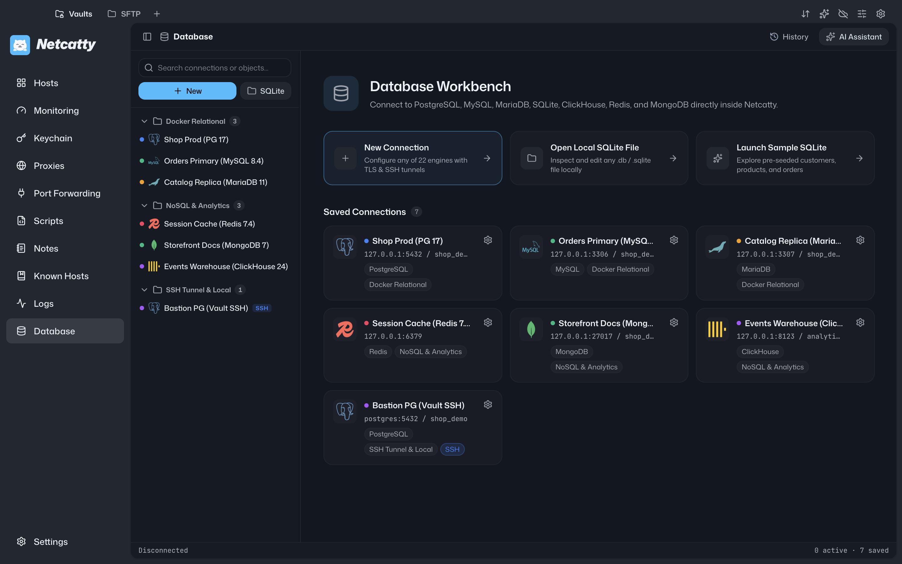 | 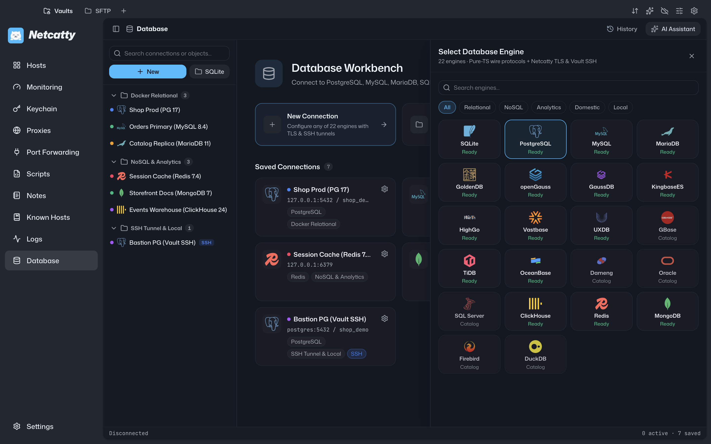 |

| PostgreSQL 17 SQL IDE (Snow Light) | 22-Engine Picker (Snow Light) |
| --- | --- |
| 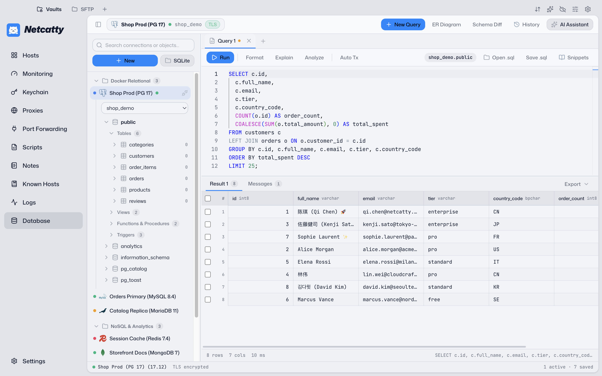 | 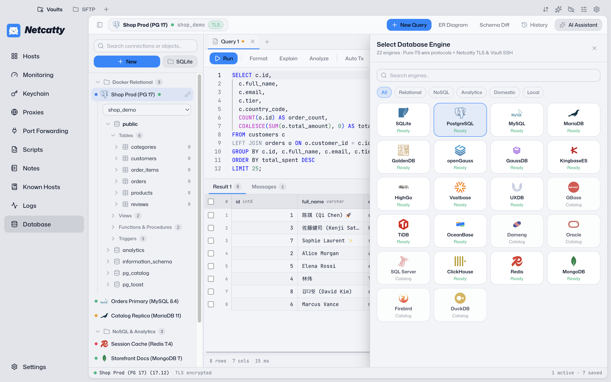 |

### SQL IDE, Inline Editing + SQL Preview, ER Diagram & Table Designer

| PostgreSQL 17 Monaco SQL IDE & Virtualized Grid | Inline Cell Editing & Pending SQL Preview Drawer |
| --- | --- |
| 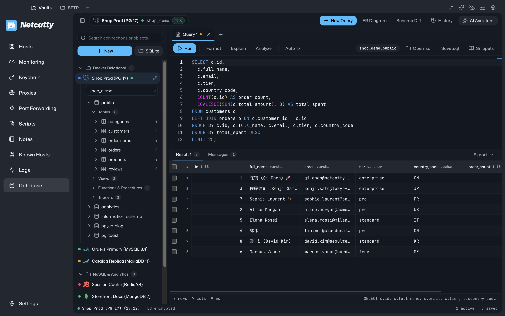 | 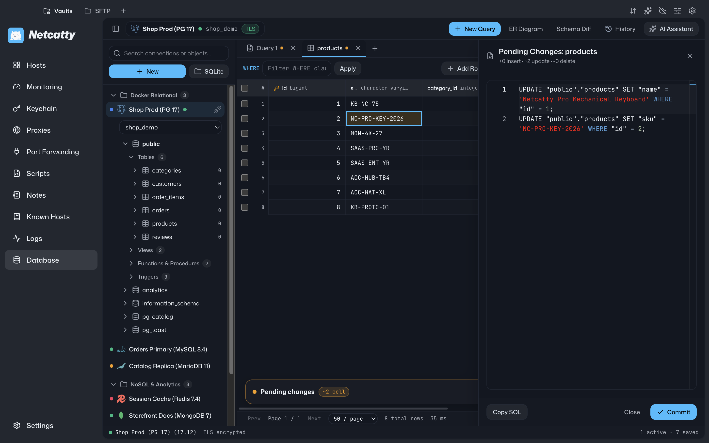 |

| Interactive ER Diagram (`PluginErCanvas`) | Table Structure Designer & DDL |
| --- | --- |
| 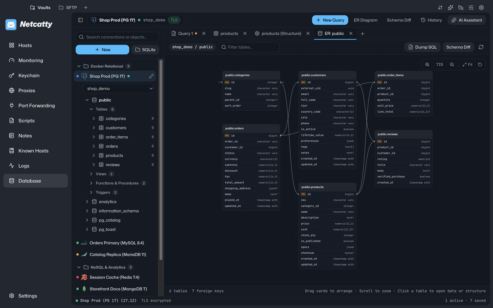 | 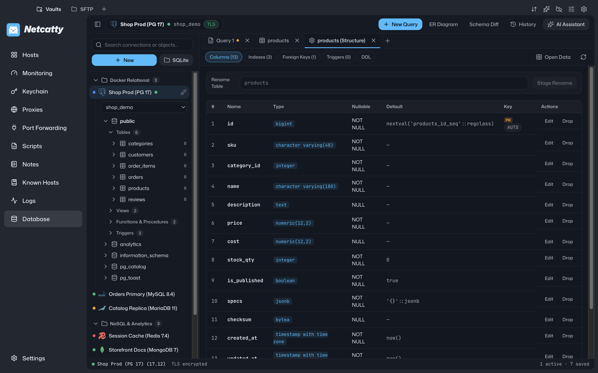 |

### Redis, MongoDB & MySQL Explain Plan

| Redis 7.4 Namespace Tree, Stream Editor & CLI | MongoDB 7 Collection & Document Workbench |
| --- | --- |
| 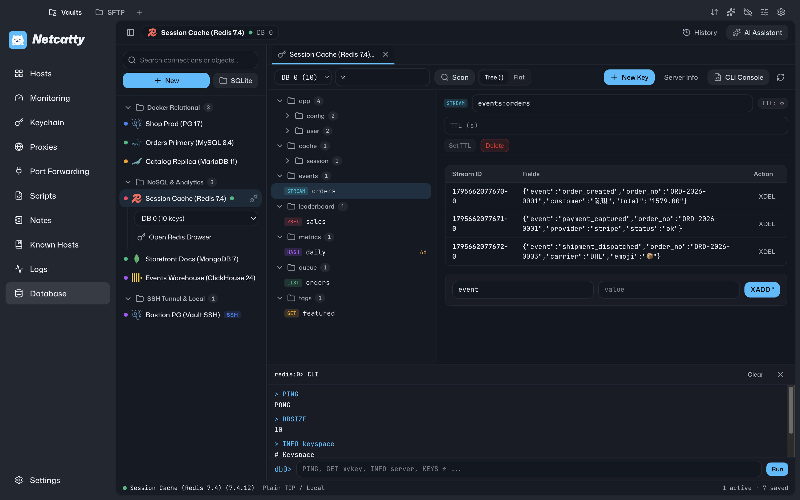 | 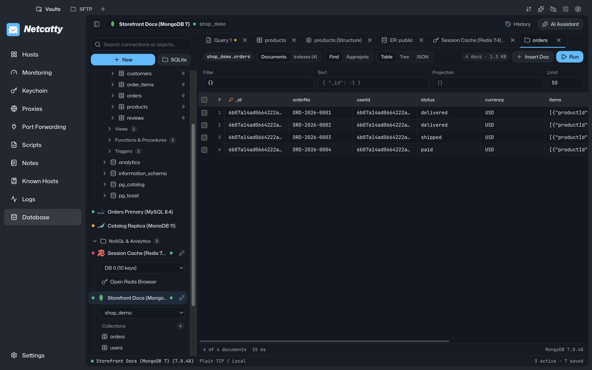 |

| MySQL 8.4 Visual Explain Plan (`TLS encrypted`) |
| --- |
| 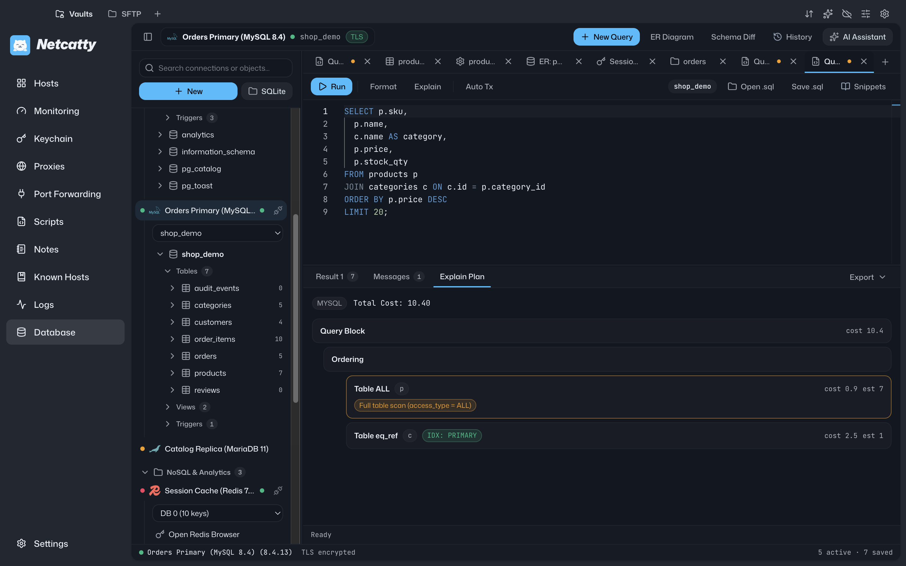 |

---

## Supported Engines

| Engine / Family | Protocol Implementation | Live Docker / File Verification |
| --- | --- | --- |
| **PostgreSQL** (+ openGauss, GaussDB, KingbaseES, HighGo, Vastbase, UXDB) | Pure-TS PG Wire v3, STARTTLS, SCRAM-SHA-256/MD5, `CancelRequest`, full OID decoders | Verified live against **PostgreSQL 17.12** (direct STARTTLS + Vault SSH Bastion tunnel) |
| **MySQL & MariaDB** (+ TiDB, OceanBase, GoldenDB) | Pure-TS MySQL Wire, STARTTLS, `caching_sha2_password` (incl. WebCrypto RSA-OAEP), `mysql_native_password`, `KILL QUERY` | Verified live against **MySQL 8.4.13** & **MariaDB 11.8.9** |
| **SQLite** | Embedded `sql.js` (asm.js) + native `ui.openFile` / `ui.saveFile` local `.db`/`.sqlite` round-trip | Verified against `tests/fixtures/shop_demo.sqlite` + in-memory sample DB |
| **Redis** | Pure-TS RESP2/RESP3, DB `0..15`, `SCAN`, 6 data types + Streams + interactive CLI | Verified live against **Redis 7.4.12** |
| **MongoDB** | Pure-TS `OP_MSG` + `bson` + WebCrypto SCRAM-SHA-256 | Verified live against **MongoDB 7.0.48** |
| **ClickHouse** | HTTP(S) `JSONCompact` / `JSONEachRow` + HTTP/1.1 over `ByteStream` (Vault SSH compatible) | Verified live against **ClickHouse 24.10** |
| **Oracle, SQL Server, Dameng, Firebird, GBase, DuckDB** | Catalog entries with crisp dual-theme SVG/PNG brand icons | Catalog metadata & icons validated |

---

## Build, Test & Package

Node `>=24` and npm are required. Vendored `@netcatty/plugin-{contract,sdk,cli}` snapshots live in `vendor/`.

```sh
npm ci --ignore-scripts
npm run lint
npm test
node --test --import tsx tests/drivers/*.test.ts tests/sql/*.test.ts tests/ui/*.test.ts
npm run pack
npm run validate
```

The packaged plugin is written to `dist/netcatty-database-0.2.0.ncpkg`. Install it in Netcatty via **Settings → Plugins → Manage → Import**.

---

## Local Multi-Database Docker Test Stack

A reproducible multi-database + OpenSSH Bastion test suite is included under `tests/docker/`:

```sh
# 1. Generate local self-signed TLS certs & ephemeral SSH bastion keypair
bash tests/docker/setup-fixtures.sh

# 2. Boot PostgreSQL 17, MySQL 8.4, MariaDB 11, Redis 7.4, MongoDB 7, ClickHouse 24 & OpenSSH Bastion
docker compose -f tests/docker/docker-compose.yml up -d

# 3. Run live integration tests against all 7 engines + tests/fixtures/shop_demo.sqlite
node --test --import tsx tests/drivers/liveIntegration.test.ts
```

---

## Security & Licenses

- Runs strictly as a **browser-only** Netcatty plugin (`main.browser: "browser.js"`). All network sockets, STARTTLS upgrades, Vault SSH tunnels, native file dialogs, and encrypted plugin secrets (`context.secrets`) are mediated and user-confirmed by the Netcatty host.
- Plugin code and host SDK snapshots are licensed under **GPL-3.0-or-later**. SQL.js is MIT, `bson` is Apache-2.0, and SQLite is public domain. Third-party database logos retain their upstream trademark/license terms documented in [NOTICE](NOTICE) and `assets/*-ledger.json`.
