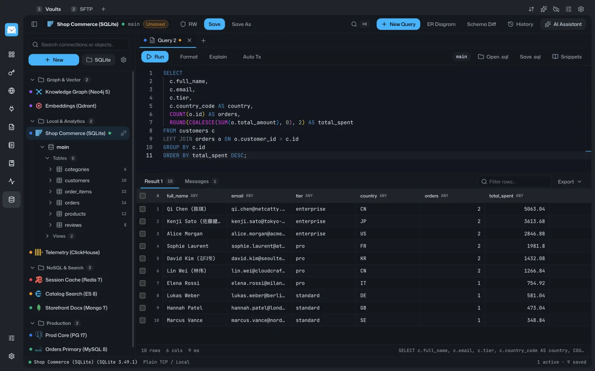
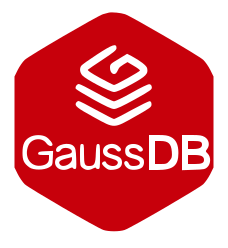
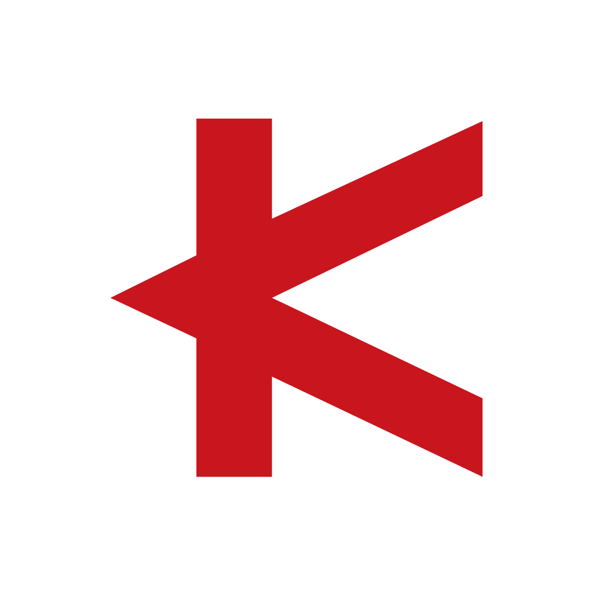
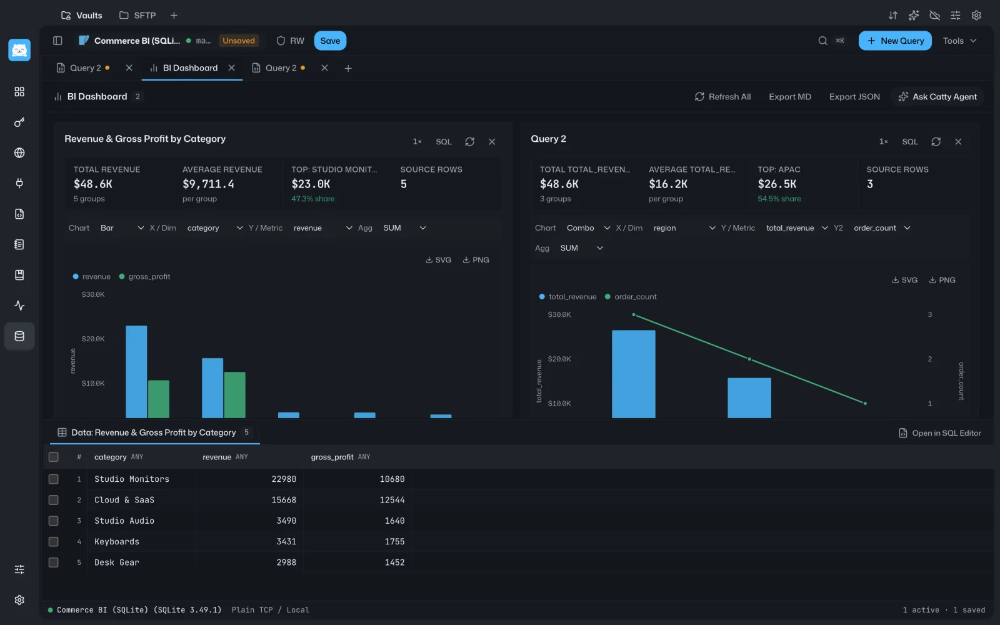
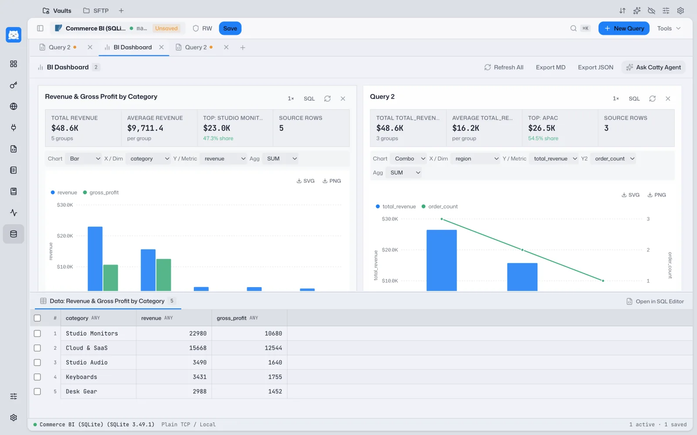
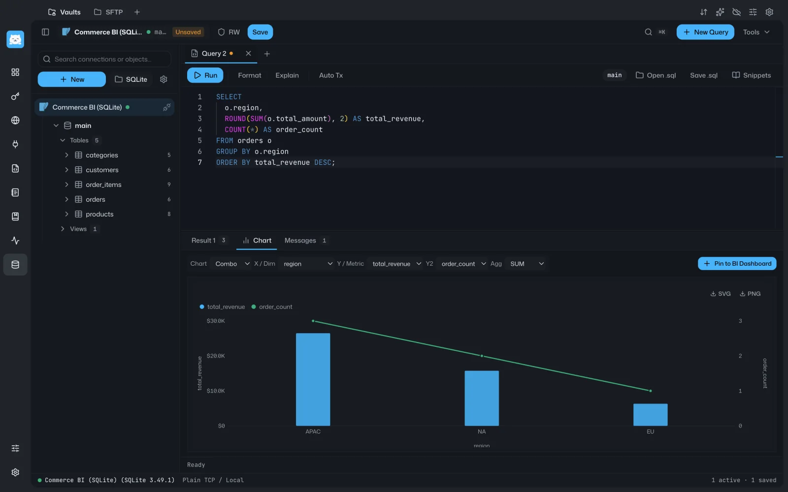
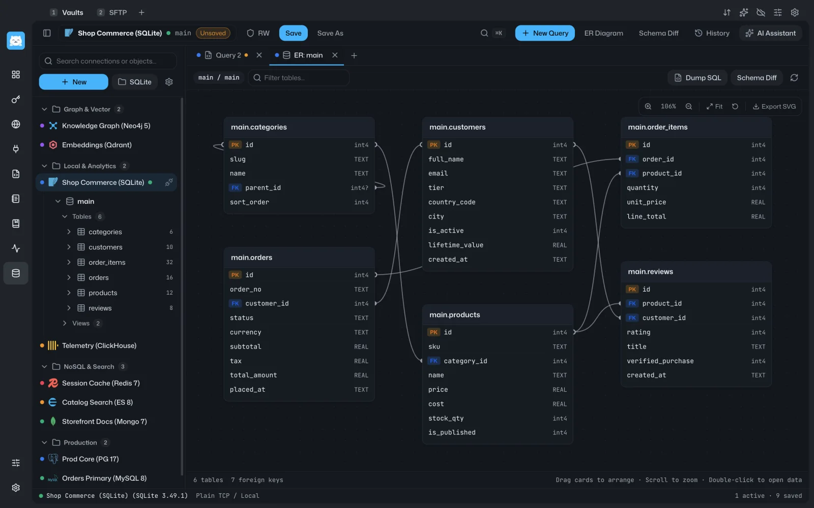
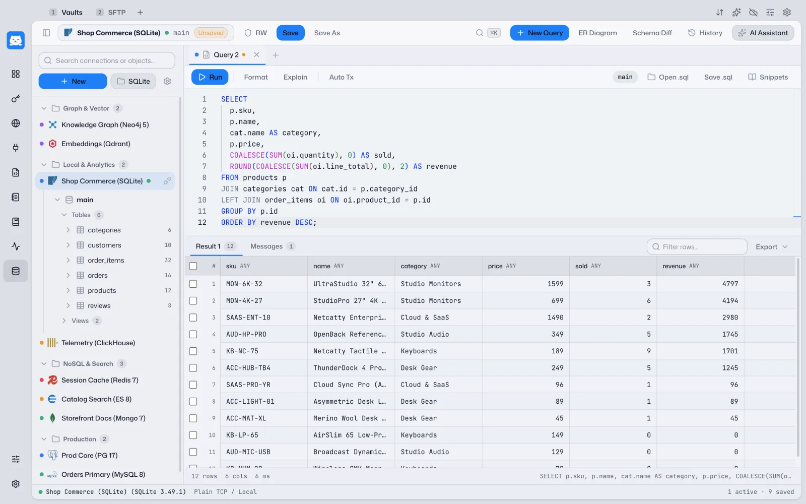
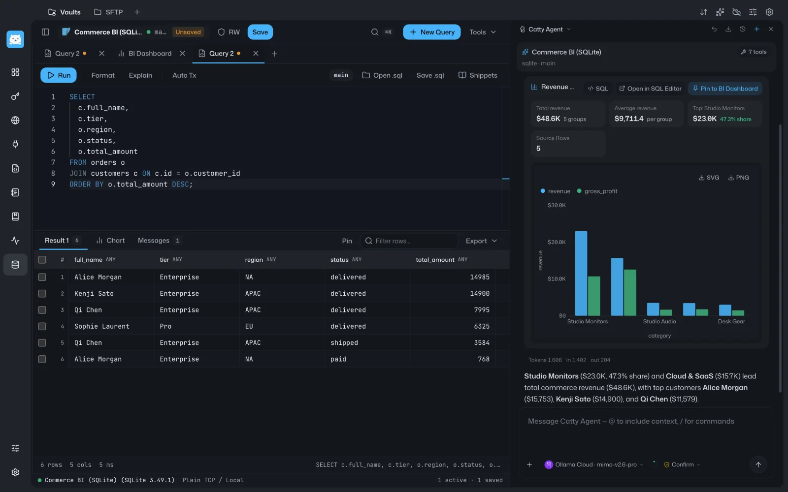
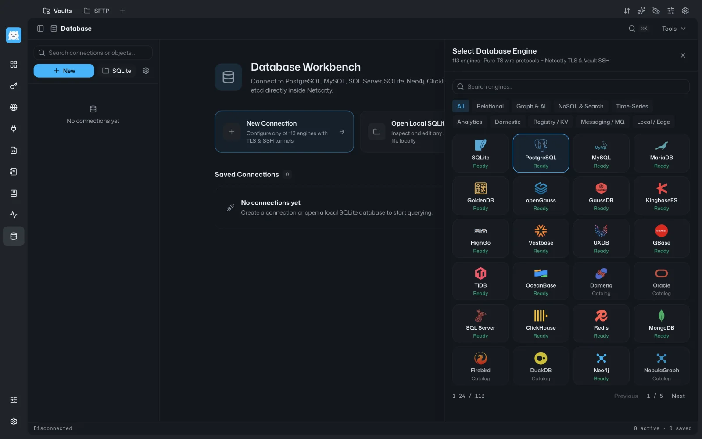

<p align="center">
  <picture>
    <source media="(prefers-color-scheme: dark)" srcset="assets/plugin-icon-dark.svg">
    <source media="(prefers-color-scheme: light)" srcset="assets/plugin-icon-light.svg">
    
  </picture>
</p>

<h1 align="center">Netcatty Database</h1>

<p align="center">
  <strong>Enterprise-grade multi-database IDE workbench built natively for Netcatty's Host-Rendered Plugin Platform.</strong>
</p>

<p align="center">
  <a href="https://github.com/binaricat/netcatty-database-plugin/actions/workflows/ci.yml"></a>
  
  
  
  
  <a href="LICENSE"></a>
</p>

<p align="center">
  <picture>
    <source media="(prefers-color-scheme: dark)" srcset="docs/screenshots/db-workbench-dark.webp">
    <source media="(prefers-color-scheme: light)" srcset="docs/screenshots/db-workbench-light.webp">
    
  </picture>
</p>

<p align="center">
  113 Engine Profiles (76 Live Pure-TS Drivers across 13 Families + 37 Catalog Entries) · PostgreSQL · MySQL · MariaDB · SQL Server (TDS 7.4) · SQLite · Neo4j (Bolt &amp; Cypher Graph) · ClickHouse · Cassandra / ScyllaDB (CQL v4) · Redis · MongoDB · Elasticsearch / Solr / Milvus / Qdrant / DynamoDB / HBase · etcd / Consul / Nacos / ZooKeeper · RabbitMQ / Pulsar / MQTT / Kafka · Catty Agent Sidebar &amp; BI Dashboard · Server Monitor · Users Admin · Data Compare · Mock Data · Data Dictionary &amp; Model Codegen · Global Search · Dolt VC · Vault SSH Tunnels
</p>

---

## Install in Netcatty

1. Open **Netcatty → Settings → Plugins → Install from GitHub** and enter:
   ```text
   binaricat/netcatty-database-plugin
   ```
2. Or download `netcatty-database-0.3.1.ncpkg` from the [latest GitHub Release](https://github.com/binaricat/netcatty-database-plugin/releases/latest) and import it via **Settings → Plugins → Manage → Import**.

---

## Supported Engines (113 Engine Profiles · 76 Live Pure-TS Drivers · 37 Catalog)

<table>
  <tr>
    <td align="center" width="150"><picture><source media="(prefers-color-scheme: dark)" srcset="assets/icons/postgresql-dark.svg"></picture><br><strong>PostgreSQL</strong><br><sub>Live · PG Wire v3</sub></td>
    <td align="center" width="150"><picture><source media="(prefers-color-scheme: dark)" srcset="assets/icons/mysql-dark.svg"></picture><br><strong>MySQL</strong><br><sub>Live · MySQL Wire</sub></td>
    <td align="center" width="150"><picture><source media="(prefers-color-scheme: dark)" srcset="assets/icons/mariadb-dark.svg"></picture><br><strong>MariaDB</strong><br><sub>Live · MySQL Wire</sub></td>
    <td align="center" width="150"><picture><source media="(prefers-color-scheme: dark)" srcset="assets/icons/sqlserver-dark.svg"></picture><br><strong>SQL Server</strong><br><sub>Live · TDS 7.4</sub></td>
    <td align="center" width="150"><picture><source media="(prefers-color-scheme: dark)" srcset="assets/icons/sqlite-dark.svg"></picture><br><strong>SQLite</strong><br><sub>Live · Local &amp; Mem</sub></td>
    <td align="center" width="150"><picture><source media="(prefers-color-scheme: dark)" srcset="assets/icons/neo4j-dark.svg"></picture><br><strong>Neo4j</strong><br><sub>Live · Bolt &amp; Cypher</sub></td>
  </tr>
  <tr>
    <td align="center"><picture><source media="(prefers-color-scheme: dark)" srcset="assets/icons/clickhouse-dark.svg"></picture><br><strong>ClickHouse</strong><br><sub>Live · HTTP/SSH</sub></td>
    <td align="center"><picture><source media="(prefers-color-scheme: dark)" srcset="assets/icons/redis-dark.svg"></picture><br><strong>Redis</strong><br><sub>Live · RESP2/3</sub></td>
    <td align="center"><picture><source media="(prefers-color-scheme: dark)" srcset="assets/icons/mongodb-dark.svg"></picture><br><strong>MongoDB</strong><br><sub>Live · OP_MSG/BSON</sub></td>
    <td align="center"><picture><source media="(prefers-color-scheme: dark)" srcset="assets/icons/elasticsearch-dark.svg"></picture><br><strong>Elasticsearch</strong><br><sub>Live · Search/REST</sub></td>
    <td align="center"><picture><source media="(prefers-color-scheme: dark)" srcset="assets/icons/qdrant-dark.svg"></picture><br><strong>Qdrant</strong><br><sub>Live · Vector API</sub></td>
    <td align="center"><picture><source media="(prefers-color-scheme: dark)" srcset="assets/icons/influxdb-dark.svg"></picture><br><strong>InfluxDB</strong><br><sub>Live · Time-Series</sub></td>
  </tr>
  <tr>
    <td align="center"><picture><source media="(prefers-color-scheme: dark)" srcset="assets/icons/tdengine-dark.svg"></picture><br><strong>TDengine</strong><br><sub>Live · Time-Series</sub></td>
    <td align="center"><picture><source media="(prefers-color-scheme: dark)" srcset="assets/icons/trino-dark.svg"></picture><br><strong>Trino</strong><br><sub>Live · HTTP SQL</sub></td>
    <td align="center"><picture><source media="(prefers-color-scheme: dark)" srcset="assets/icons/cockroachdb-dark.svg"></picture><br><strong>CockroachDB</strong><br><sub>Live · PG Wire</sub></td>
    <td align="center"><picture><source media="(prefers-color-scheme: dark)" srcset="assets/icons/doris-dark.svg"></picture><br><strong>Apache Doris</strong><br><sub>Live · MySQL Wire</sub></td>
    <td align="center"><picture><source media="(prefers-color-scheme: dark)" srcset="assets/icons/etcd-dark.svg"></picture><br><strong>etcd</strong><br><sub>Live · KV v3</sub></td>
    <td align="center"><picture><source media="(prefers-color-scheme: dark)" srcset="assets/icons/consul-dark.svg"></picture><br><strong>Consul</strong><br><sub>Live · KV API</sub></td>
  </tr>
  <tr>
    <td align="center"><picture><source media="(prefers-color-scheme: dark)" srcset="assets/icons/tidb-dark.svg"></picture><br><strong>TiDB</strong><br><sub>Live · MySQL Wire</sub></td>
    <td align="center"><picture><source media="(prefers-color-scheme: dark)" srcset="assets/icons/oceanbase-dark.svg"></picture><br><strong>OceanBase</strong><br><sub>Live · MySQL Wire</sub></td>
    <td align="center"><picture><source media="(prefers-color-scheme: dark)" srcset="assets/icons/opengauss-dark.svg"></picture><br><strong>openGauss</strong><br><sub>Live · PG Wire</sub></td>
    <td align="center"><picture><source media="(prefers-color-scheme: dark)" srcset="assets/icons/gaussdb-dark.svg"></picture><br><strong>GaussDB</strong><br><sub>Live · PG/MySQL</sub></td>
    <td align="center"><picture><source media="(prefers-color-scheme: dark)" srcset="assets/icons/kingbase-dark.svg"></picture><br><strong>KingbaseES</strong><br><sub>Live · PG Wire</sub></td>
    <td align="center"><picture><source media="(prefers-color-scheme: dark)" srcset="assets/icons/goldendb-dark.svg"></picture><br><strong>GoldenDB</strong><br><sub>Live · MySQL Wire</sub></td>
  </tr>
</table>

<details>
<summary><strong>Protocol &amp; Live Verification Matrix (All 113 Engine Profiles · 76 Live across 13 Families + 37 Catalog)</strong></summary>

| Engine / Family | Protocol Implementation | Live Docker / File Verification |
| --- | --- | --- |
| **PostgreSQL** (+ openGauss, GaussDB, KingbaseES, HighGo, Vastbase, UXDB, GBase 8c PG-mode, CockroachDB, Redshift, Cloudberry, OpenTenBase, QuestDB, KWDB, Custom PG) | Pure-TS PG Wire v3, STARTTLS, SCRAM-SHA-256/MD5, `CancelRequest`, `switchDatabase`, `QueryError` line/col, full OID decoders, Sequences, Custom Types, Extensions (Installed + Available), Event Triggers, Rules, Partitions | Verified live against **PostgreSQL 17.12** (direct STARTTLS + Vault SSH Bastion tunnel) |
| **MySQL & MariaDB** (+ TiDB, OceanBase MySQL & Oracle Mode, GoldenDB, Doris, StarRocks, SelectDB, PolarDB, TDSQL, GreatSQL, Dolt, Manticore Search, Custom MySQL) | Pure-TS MySQL Wire, STARTTLS, `caching_sha256_password` (incl. WebCrypto RSA-OAEP), `mysql_native_password`, `KILL QUERY`, `EXPLAIN ANALYZE`, Scheduled Events, OceanBase Oracle (`ALL_*` + `DBMS_METADATA.GET_DDL`), Dolt Version Control | Verified live against **MySQL 8.4.13** & **MariaDB 11.8.9** |
| **SQL Server (MSSQL)** | Pure-TS TDS 7.4 wire protocol (`PRELOGIN`, TLS, `LOGIN7`, `SQL_BATCH`, `COLMETADATA`/`ROW`/`NBCROW`/`ERROR` tokens), schema/FK/index/ER introspection, Sequences, Synonyms, Linked Servers | Protocol & mock-server verified (`tests/drivers/neo4jMssqlDriver.test.ts`) |
| **Neo4j (Graph)** | Pure-TS **Bolt v4.4/v5.x + PackStream v1** binary wire protocol + HTTP Cypher API (`/query/v2`, `/tx/commit`), Labels/Rels/Indexes/Constraints browser, Node/Rel CRUD + EXPLAIN/PROFILE, interactive Graph Canvas (`PluginErCanvas`) + Table/JSON views | Protocol & mock-server verified (`tests/drivers/neo4jMssqlDriver.test.ts`, `tests/databaseSpecialists.test.mjs`) |
| **SQLite** | Embedded `sql.js` (lazy-split asm.js) + native `ui.openFile` / `ui.saveFile` / `writeFileHandle` in-place save, dirty tracking, schema-level Indexes & dependencies | Verified against `tests/fixtures/shop_demo.sqlite` + in-memory sample DB |
| **Wide-Column (Cassandra / ScyllaDB)** | Pure-TS **CQL v4** binary protocol over `ByteStream` (`STARTUP`/`AUTH`/`QUERY`), keyspace/table/type introspection & CQL editor | Protocol & mock-server verified (`tests/databaseNewDrivers.test.mjs`) |
| **Redis** | Pure-TS RESP2/RESP3, DB `0..15`, cursor `SCAN`, 6 data types + Streams (`XADD`/`XDEL`/`XTRIM`), Slowlog, Clients, CommandStats, Gzip preview, Server Info Dashboard, Pub/Sub, CLI w/ history | Verified live against **Redis 7.4.12** & `tests/databaseSpecialists.test.mjs` |
| **MongoDB & MongoDB Legacy** | Pure-TS `OP_MSG` + lazy-split `bson` + EJSON + WebCrypto SCRAM-SHA-256 + Explain + Bulk EJSON + GridFS + Validation + Users + Schema Analyzer + Collection CRUD | Verified live against **MongoDB 7.0.48** & `tests/databaseSpecialists.test.mjs` |
| **ClickHouse** | HTTP(S) `JSONCompact` / `JSONEachRow` + HTTP/1.1 over `ByteStream` (Vault SSH compatible), Dictionaries, Partitions, Processes, Server Metrics | Verified live against **ClickHouse 24.10** |
| **HTTP SQL, Cloud & Time-Series** (Trino, PrestoSQL, Databend, RQLite, Turso/libSQL, Cloudflare D1, TDengine, InfluxDB v1/v2/v3, VictoriaMetrics, IoTDB, Kylin, Databricks SQL, Snowflake, BigQuery, Salesforce SOQL) | Pure-TS HTTP(S) & HTTP/1.1-over-ByteStream `RelationalDriver`s (SSH-tunnel compatible) | Protocol & mock-server verified (`tests/drivers/httpEnginesDriver.test.ts`, `tests/databaseNewDrivers.test.mjs`) |
| **Search, Document & Vector** (Elasticsearch, Easysearch, Meilisearch, CouchDB, Solr, Milvus, Qdrant, ChromaDB, Weaviate, DynamoDB SigV4, HBase REST) | Pure-TS HTTP(S) & ByteStream `SearchDriver` + Search/Mapping/REST/Admin Workbench | Protocol & mock-server verified (`tests/drivers/httpEnginesDriver.test.ts`, `tests/databaseSpecialists.test.mjs`) |
| **Registry & Config KV** (etcd v3 & v2, Consul KV/Services/ACL, Nacos History/Diff, Apache ZooKeeper Jute/4LW) | Pure-TS HTTP(S) & ByteStream `KvDriver` + Prefix/Namespace KV Workbench | Protocol & mock-server verified (`tests/drivers/httpEnginesDriver.test.ts`, `tests/databaseSpecialists.test.mjs`, `tests/databaseNewDrivers.test.mjs`) |
| **Messaging & Event Brokers** (RabbitMQ Management HTTP, Apache Pulsar Admin HTTP / `mq`, MQTT v3.1.1/v5.0, Apache Kafka Binary Wire + SASL PLAIN) | Pure-TS `MqDriver` + dedicated **MQ Workbench Tab** (Overview, Queues/Topics, Exchanges, Bindings, Publish/Peek) | Protocol & mock-server verified (`tests/databaseNewDrivers.test.mjs`) |
| **37 Native/Proprietary Catalog Entries** (Oracle, Dameng, Firebird, DuckDB, NebulaGraph, etc.) | Honest catalog entries with dual-theme SVG/PNG icons & protocol variant disclosures (require native/proprietary drivers outside browser sandbox) | Catalog metadata & icons validated |

</details>

---

## Highlights (`v0.3.1`)

- **100% Host-Rendered & Sandbox-Isolated (`main.browser`)** — Pure TypeScript wire-protocol engines running inside Netcatty's offline browser plugin sandbox (zero iframes, zero `eval`/`new Function`, zero Node companion required), paired with Netcatty's host-rendered native IDE primitives (`PluginCodeEditor`, `PluginDataGrid`, `PluginSplitPane`, `PluginErCanvas`, `PluginBiChart`).
- **Catty Agent BI & Persistent BI Dashboard (`PluginBiChart`) across 53 Engines (SQL/CQL/HTTP-SQL + MongoDB Aggregation) + 1-Click SQL Result `Chart` Tab** — Ask business questions directly in Netcatty's native **Catty Agent Sidebar** (`context.ai`, schema-only metadata, strict read-only SQL guards `LIMIT 500` / `TOP 500` & MongoDB read-only pipeline guards blocking `$out`/`$merge`, inline interactive `PluginBiChart` artifacts, and 1-click **Pin to BI Dashboard**). Also works 100% offline via the instant **`Chart`** subtab inside SQL Query Results and **`Pin to BI`** on MongoDB Aggregation results across **10 host-rendered chart types** (`bar`, `horizontal-bar`, `stacked-bar`, `line`, `area`, `pie`, `donut`, `scatter`, `funnel`, `combo`) with live Dimension/Measure/Aggregation (`SUM`/`AVG`/`COUNT`/`MIN`/`MAX`) switching, click-to-cross-filter across sibling cards & `PluginDataGrid`, persistent per-connection **BI Dashboards**, and **SVG / 2× PNG / Markdown / JSON** export.
- **113 Engine Profiles (76 Live Pure-TS Drivers across 13 Families + 37 Catalog Entries)** — Bounded paginated engine picker with 10 categories (incl. `Messaging / MQ`), Protocol Variant selector, dual-theme SVG/PNG icons, plus JSON & DBeaver `data-sources.json` connection import/export.
- **Full DBA & Developer Power Suite (`Tools ▾`)** — **Server Monitor & Processlist** (live QPS/TPS, cache hit, kill session), **Users & Roles Admin** (grants & password management), **Row-by-Row Data Compare** (dialect-aware sync SQL), **Mock Data Generator** (presets, Luhn, batched INSERTs), **Data Dictionary & 7-Language Model Codegen** (Markdown / HTML / DBML / TS / Go / Rust / Python / Java / SQL / Prisma), **Global Object & Cross-Table Data Search**, **Dolt Version Control** (branches/commits/diff/merge), and **Multi-DB Batch Execution + Pinned Result Diff**.
- **Native Netcatty Vault SSH Tunnels & TLS/STARTTLS** — Connect directly over user-approved TCP/TLS, upgrade in-band via STARTTLS (`SSLRequest` / `CLIENT_SSL`) with explicit certificate fingerprint verification, or tunnel through any existing Netcatty Vault SSH host with durable revocable bindings (reusing Netcatty's SSH keys, jump hosts, and MFA without exposing credentials).
- **Command Palette (`Cmd/Ctrl+K`) & Global IDE Shortcuts** — Fuzzy-jump across Actions, Open Tabs, Connections, and Tables/Views/Collections (`⌘K`), open tabs (`⌘T`), close tabs (`⌘W`), save/commit (`⌘S`), multi-step grid Undo/Redo (`⌘Z` / `⌘⇧Z`), and `Esc` dismissal.
- **Read-Only Safe Mode & Destructive SQL Guard** — 1-click Read-Only lock per connection (blocks all SQL/grid/DDL/import/restore/transfer/Redis/Mongo writes) plus automatic destructive SQL risk classification (`DROP`, `TRUNCATE`, `DELETE`/`UPDATE` without `WHERE`) with review confirmation drawer.
- **Multi-Tab SQL IDE** — Host Monaco SQL editor with dialect highlighting (`pgsql` / `mysql` / `sql`), local schema-aware autocomplete, **SQL Parameter Prompt** (`:name`, `$1`, `?`, `{{var}}`), live syntax + server `QueryError` line/column diagnostics, multi-statement execution, real query cancellation (`CancelRequest` / `KILL QUERY`), `Auto` / `Manual` transaction controls, **PostgreSQL & MySQL 8 `EXPLAIN ANALYZE`** plan trees with cost-share bars & Raw Plan toggle, persistent query history & snippets, and **1-click Fix with AI**.
- **Virtualized Editable Data Grid** — Server-side pagination, sorting, manual `WHERE` + **Visual WHERE Filter Builder**, **Column Visibility Picker**, **inline Foreign Key Jump (`↗`)**, double-click inline cell editing with `NULL` toggle, **multi-step Undo/Redo**, amber dirty-cell highlighting, floating pending-changes bar, docked Monaco SQL preview, atomic commit/rollback, Cell/Row Inspector drawer, and file export/import (**CSV / JSON / Markdown / SQL INSERT / XLSX** via native host file dialogs).
- **Table Structure Designer, Object Definitions, Interactive ER & Graph Diagrams & Cross-Connection Diff / Restore / Data Transfer**:
  - Edit columns (`Default`, `Unique`, `Auto Inc`, `Comment`), indexes, **Foreign Keys**, **CHECK constraints**, **Partitions**, triggers, and DDL; inspect, edit & compile Views, Materialized Views (`Refresh MV`), **Functions & Procedures (with live `Execute Routine` parameter runner)**, Triggers, Sequences, Events, Custom Types, Extensions (Installed + Available), Event Triggers, Rules, Dictionaries, Synonyms, and Linked Servers in **Object Definition Tabs**.
  - Visualize table relationships and Neo4j Cypher graphs with pan/zoom/draggable cards, blue `FK` pills, exact column-to-column Bezier curves, double-click to open data, and **SVG Export**.
  - Compare schemas across connections with selectable migration items, generate selective `.sql` dumps, **Restore `.sql` files** with live progress, and run **Cross-Connection Table Data Transfer** (e.g. PostgreSQL ↔ SQLite ↔ MySQL) with automatic column type translation.
- **Specialist NoSQL, Graph, Search, Vector & KV Workbenches**:
  - **Redis**: DB `0..15` switcher with key counts, `:` namespace tree & flat views, `MATCH` scanning with cursor `Load More`, structured CRUD + inline editing for **String / Hash / List (`LSET`) / Set / ZSet / Stream**, **Server Info Dashboard**, live **Pub/Sub**, and interactive **Redis CLI**.
  - **MongoDB**: Pure-TS `OP_MSG` + BSON + SCRAM-SHA-256 driver with **Extended JSON (EJSON)** filters/edits, **Table / Tree / JSON** views, multi-line **Aggregate** Monaco editor, index management, and **Schema Analyzer**.
  - **Neo4j, Elasticsearch / Qdrant, etcd / Consul / Nacos & SQLite**: Dedicated Graph/Cypher, Search/Vector REST, Prefix/Namespace KV, and embedded `sql.js` in-place save workbenches.
- **Full Bilingual UI (English & 简体中文)** — Automatically tracks Netcatty's locale setting across every toolbar, explorer node, tab, drawer, and status bar.

---

## Screenshots

| BI Dashboard (Midnight Dark) | BI Dashboard (Snow Light) |
| --- | --- |
|  |  |

| SQL IDE Instant `Chart` Result Tab (Midnight Dark) | Interactive ER Diagram & Foreign Key Canvas (Midnight Dark) |
| --- | --- |
|  |  |

| SQL IDE & Virtualized Grid (Midnight Dark) | SQL IDE & Virtualized Grid (Snow Light) |
| --- | --- |
|  |  |

| Catty Agent Contextual Sidebar + Zero-Overflow Topbar (Midnight Dark) | 113-Engine Catalog & Paginated Connection Picker (Midnight Dark) |
| --- | --- |
|  |  |

---

## Build, Test & Package

Node `>=24` and npm are required. Vendored `@netcatty/plugin-{contract,sdk,cli}` snapshots live in `vendor/`.

```sh
shasum -a 256 -c vendor/SHA256SUMS
npm ci --ignore-scripts
npm run lint
npm test
node --test --import tsx tests/drivers/*.test.ts tests/sql/*.test.ts tests/ui/*.test.ts
npm run pack
npm run validate
```

The packaged plugin is written to `dist/netcatty-database-0.3.1.ncpkg`. Install it in Netcatty via **Settings → Plugins → Manage → Import**.

---

## Local Multi-Database Docker Test Stack

A reproducible multi-database + OpenSSH Bastion test suite is included under `tests/docker/`:

```sh
# 1. Generate local self-signed TLS certs & ephemeral SSH bastion keypair
bash tests/docker/setup-fixtures.sh

# 2. Boot PostgreSQL 17, MySQL 8.4, MariaDB 11, Redis 7.4, MongoDB 7, ClickHouse 24 & OpenSSH Bastion
docker compose -f tests/docker/docker-compose.yml up -d

# 3. Run live integration tests against all 7 engines + tests/fixtures/shop_demo.sqlite
node --test --import tsx tests/drivers/liveIntegration.test.ts
```

---

## Security & Licenses

- Runs strictly as a **browser-only** Netcatty plugin (`main.browser: "browser.js"`). All network sockets, STARTTLS upgrades, Vault SSH tunnels, native file dialogs, and encrypted plugin secrets (`context.secrets`) are mediated and user-confirmed by the Netcatty host.
- Plugin code and host SDK snapshots are licensed under **GPL-3.0-or-later**. SQL.js is MIT, `bson` is Apache-2.0, and SQLite is public domain. Third-party database logos retain their upstream trademark/license terms documented in [NOTICE](NOTICE) and `assets/*-ledger.json`.
